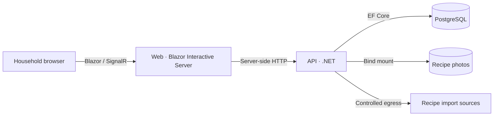

# Architecture and trust boundary

**Purpose:** explain the application's responsibility and the minimum access rules. This is the **configured design**, not proof of a live firewall or authorization policy.

[Compose](../../deploy/docker-compose.yml) places **only Web** on the shared `edge` network (alias `what-to-cook-web`); the API and database are not published as browser-facing services. API also joins `egress` and `observability`. Homelab owns the reverse proxy, TLS/WebSocket forwarding and external network policies.

## Trust rule

**Do not expose the API or the app to untrusted users as-is.** The application does not currently enforce per-user API authorization. A trusted LAN, VPN or proxy limits reachability but is not user authentication. Web antiforgery is not API authorization either.

Before expanding beyond the trusted household, decide user/household ownership, enforce authorization on API writes and uploads, and verify the real network routes, importer egress, CSRF and image-access policy. The [deployment checklist](../self-hosted-deployment.md) covers operator-owned prerequisites; none are certified by this document.

## Code ownership and contracts

- **Web:** server-rendered interactive UI and feature-local API clients ([startup](../../src/WhatToCook.Web/Program.cs)).
- **API:** validation, recipe/plan/shopping flows, migrations and image storage ([startup](../../src/WhatToCook.Api/Program.cs)).
- **Homelab:** shared networks, Komodo/Periphery, secrets, persistent host paths and restore.

Web and API are separate deployables. Their JSON contracts stay **feature-local**; do not introduce a shared DTO assembly just for convenience. Contract tests such as `RecipeCatalogHttpContractTests` and `RecipeCatalogClientContractTests` verify the consumer boundary. Coordinate deployments when a response changes incompatibly; OpenSpec records intended behavior, not proof of API/Web compatibility.
